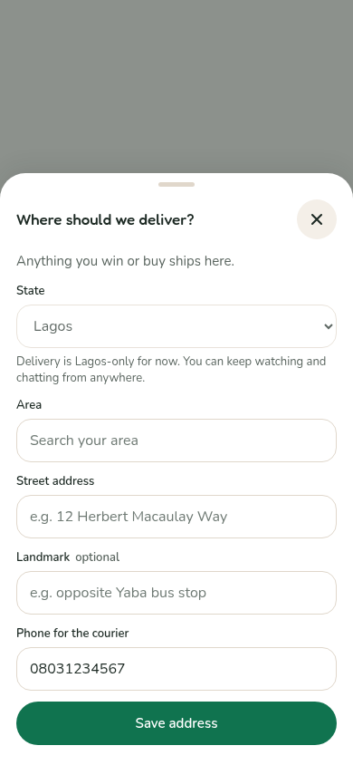
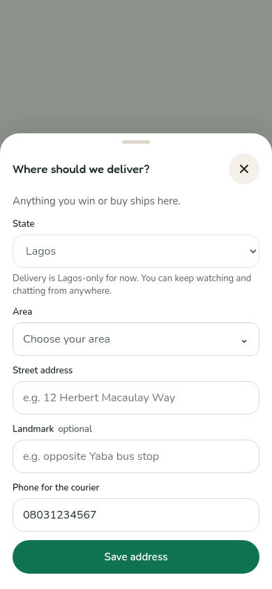
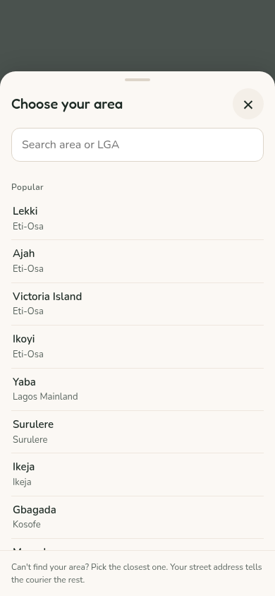
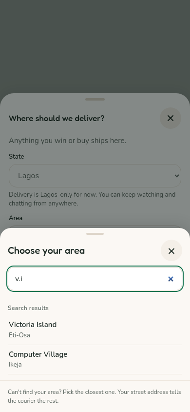
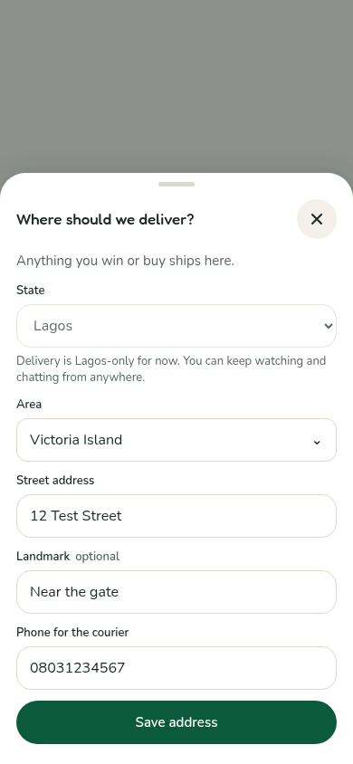
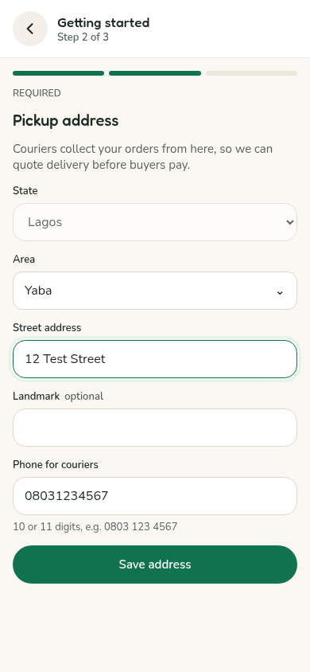

# Area picker

Buyer sign-up/one-step checkout and the standalone delivery sheet share one `AreaPicker`. Seller pickup uses its studio counterpart through `ServiceArea` and `Start`. The two components, search helpers and styles are identical, with a consistency test to keep them that way. No new Render settings are required.

The field is a button. It opens a bottom sheet on phones and a centred dialog on desktop, with Popular first, then Island/Mainland, area names and muted LGAs. Search matches area, LGA and aliases while ignoring case, spaces and punctuation. VI and V.I. find Victoria Island. Selecting closes the picker and restores focus. On phones, opening it does not automatically focus the search input, keeping Popular choices visible before the keyboard is requested. Escape closes only the picker when it is nested inside an address sheet. Search text cannot become the saved address.

The API publishes picker metadata alongside the existing service-area configuration. Area/LGA names still come from `server/src/data/lagosAreas.json`; no app has a separate geographic list. Server metadata owns popular ranking and Island/Mainland grouping. The old native datalist and its loader remain behind an inactive local flag for reference. Older API responses still render a list from their server-provided areas during a rolling deployment.

New buyer and seller address writes accept only listed areas for an allowed state. The server derives the canonical area and LGA, rejects unknown areas or mismatched LGAs with “Choose your area from the list.” and saves `city` plus optional `lga`. Order address snapshots retain LGA too. Changing city without supplying LGA derives the new LGA rather than carrying over the previous one.

There is currently an approved directory only for Lagos. Enabling another state does not invent an approved area list: new addresses there need that directory before they can be saved. Existing saved addresses in allowed states continue to work. No directory validation was added to reading addresses, bidding, buying or seller go-live checks. Editing a legacy address requires choosing a listed area.

Shipbubble receives `street, landmark if present, area, LGA, Lagos, Nigeria`. Pickup, saved delivery and typed preview addresses share the formatter; older known areas can have LGA inferred without rewriting data, and unknown legacy locations retain the old usable format. Area-only estimates include the LGA when known. Address cache keys follow the new full string, so older cached validation codes may be refreshed. The typed quote refreshes after an area/LGA or landmark change; saved-address quote refresh keys include those fields as well.

## Phone screenshots

390px captures use real components, mocked API calls and invented contacts. The before image is rendered from the starting main commit, not recreated by hand. No staging accounts were used.

| Before: datalist input | After: closed picker field |
| --- | --- |
|  |  |

| Open picker | Search results |
| --- | --- |
|  |  |

| Chosen area | Seller pickup |
| --- | --- |
|  |  |

[Seller picker](screenshots/area-picker/seller-open-picker.png) · [Desktop dialog](screenshots/area-picker/desktop-dialog.png) · [Updated delivery price](screenshots/area-picker/area-change-price.png)

No horizontal overflow or cramped fields were observed at 390px. The list scrolls independently, keeping search and the courier note visible. Browser automation uses Chromium; checking the actual iPhone keyboard/viewport remains a staging check.

Validation: all 3,867 server tests were verified across 261 suites. The full run passed 260 suites; the unrelated coupons suite hit a temporary MongoDB port collision and all five of its tests passed on isolated rerun. Both production builds, 11 buyer tests, 31 studio tests, picker browser checks and combined saved-card/bank/popup checkout checks passed.

## Checks

Unit/API checks cover area/LGA/VI search, grouping/popular order, identical buyer/studio picker source and styling, rejection of unknown areas and mismatched LGAs, persisted LGA, Shipbubble formatting, optional LGA and legacy reads/bids.

Browser checks cover opening/searching/selecting/saving, LGA in the request, quote refresh, desktop centring and nested Escape. The combined top-up browser checks cover saved-card, bank-transfer and popup funding with a picker-selected address and a mocked delivery quote; the address is saved once and Pay still waits for the price.

Run `PLAYWRIGHT_MODULE=<path-to-playwright> node tests/visual/area-picker.browser.mjs` against local buyer/seller dev servers (defaults 5175/5174). It captures the baseline temporarily from main commit 364c741d and removes the temporary component afterward. Run the existing `buyer-web/tests/topups.browser.mjs` for the combined checkout regression.

## How to check on staging

1. On iPhone, open the buyer address sheet and tap Area. Confirm a clear sheet opens with Popular choices and scrollable Island/Mainland groups. Search `vi`, `v.i`, `Lekki` and an LGA name.
2. Choose an area, confirm the sheet closes and the button shows the choice. Save, reopen/read the address and confirm its area/LGA.
3. In a new-buyer/one-step bid or buy flow, complete the street/phone fields and switch areas. Confirm the delivery price refreshes and Pay waits for the new quote. Complete a staging top-up only if desired.
4. In seller pickup setup, choose an area and save. Confirm the pickup address retains the LGA.
5. Confirm a previously saved address without LGA still loads and can be used for a bid. Unknown new area text sent directly to an address-save API should be refused with the plain message.
6. On desktop, confirm the picker is centred and keyboard focus stays inside it. Escape should leave the underlying address sheet open.
