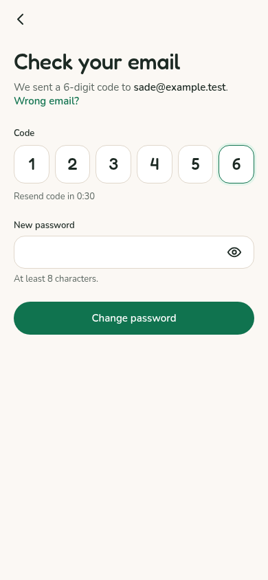
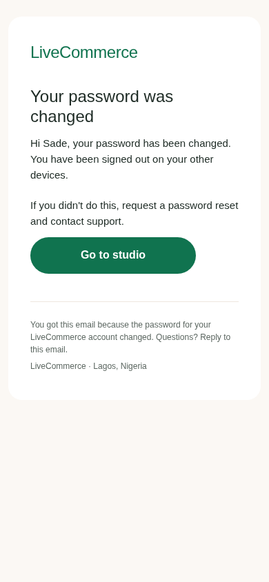
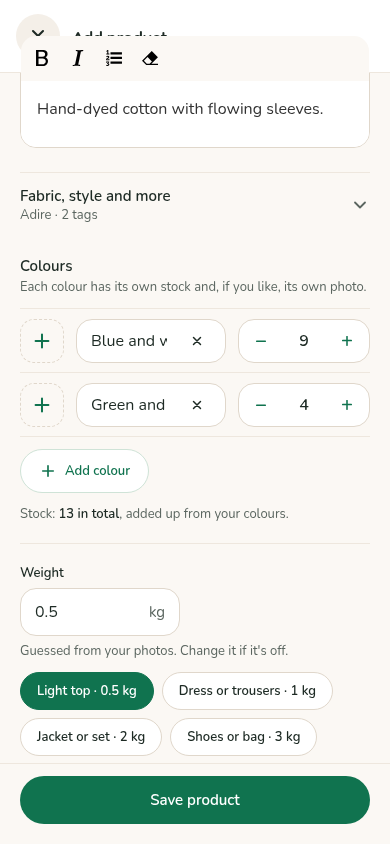
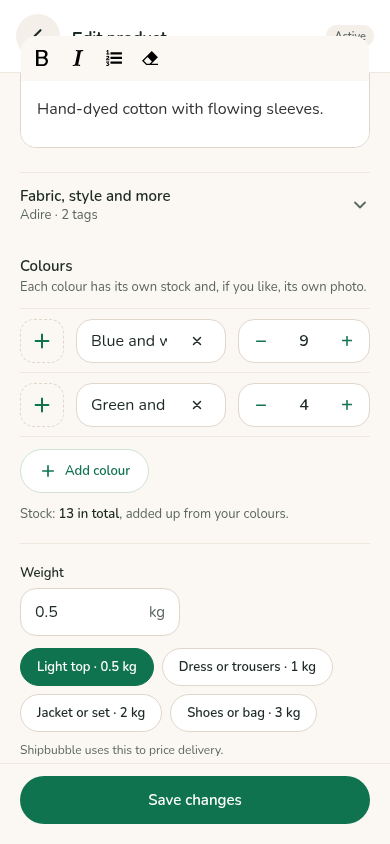

# Reset security and editable listing colours

Password recovery uses one shared engine for buyers and sellers. Codes have six digits from `crypto.randomInt`, expire after 15 minutes and are stored as keyed hashes. Five wrong guesses cancel the challenge, including its email link. Asking for a new code replaces the previous challenge. Old plaintext reset handlers and fields remain inactive; they are never accepted as recovery credentials.

Reset endpoints allow at most 30 requests per IP in 15 minutes. Requests to send/resend share a quota of five per email per 15-minute window; verification/reset endpoints share a quota of 20. Email counters live in MongoDB, so changing app instances does not reset them. IP counters use the existing Express process-local limiter. Token links resolve to the same email quota as typed codes. Rate checks fail closed if their database is unavailable. On Render, Express trusts one proxy hop so requests are limited by the client IP rather than the shared proxy. Direct local requests use their socket IP. Recovery request bodies are redacted from monitoring alerts.

Known and unknown emails receive the same response. Successful resets increment the account’s session version: old JWTs cannot access protected routes, renew a token or send authenticated socket events. Existing tokens keep working until their account resets its password; no migration/sign-out for unaffected accounts. Reset success sends the branded password-change email. Delivery failures are logged without exposing codes or changing the reset response. APP_NAME supplies the brand, as for existing auth emails. No new required environment settings.

The studio reset form has six boxes with paste and phone autofill support. Both existing email-link formats remain supported. Listing-agent colours and saved product colours populate the existing editable colour rows, including their stock. Add/remove/name/stock changes save `colourVariants` and `colourQuantities`, and total stock is the sum of colour stocks. Legacy variant metadata is retained. SKU and barcode were already inside the collapsed “Fabric, style and more” section and remain there.

Help copy lives in `seller-web/src/studio/helpCopy.js`. Returns and Fees use the exact temporary policy placeholders supplied for this change.

Validation: 255 server suites / 3,785 tests passed; 28 studio tests and 7 buyer tests passed; both production builds passed. The browser form checks passed at 390px, including six-digit paste, both reset links, draft/saved colour edits and their saved totals.

## Phone screenshots

All use invented data and a 390px viewport. No accounts were created or email sent.

| Six-digit code | Password changed email |
| --- | --- |
|  |  |

| Listing-agent draft colours | Saved product colours |
| --- | --- |
|  |  |

At 390px, the existing colour-name inputs are narrow: long names scroll inside the input rather than fitting at once. Their layout was left unchanged.

## How to check on staging

1. Request a seller password reset. Confirm the email has a six-digit code, a 15-minute expiry and a working reset button.
2. Enter a wrong code five times. Then enter the correct code: it must be refused, and a new code must be requested.
3. Request another code. Confirm the previous code/link is refused. Complete the new reset. Check that a previously signed-in second device must sign in again and the password-change email arrives.
4. Repeat for buyer recovery, using the existing buyer reset API/client flow. Check an expired challenge and a missing email; the latter must have the same response as a registered email.
5. Open an AI listing with multiple colours in Edit product. Change stock, remove a colour and add another. Save, reopen and confirm both colour counts and their summed total. Repeat on an existing saved product.
6. Open Help. Returns and Fees must show the supplied placeholders. SKU and barcode should appear only after expanding “Fabric, style and more”.

Automated browser checks: `PLAYWRIGHT_MODULE=<path-to-playwright> node tests/visual/reset-and-colours.browser.mjs` against a local seller dev server (defaults to port 5174). API calls are intercepted with invented data. It checks paste, both email-link formats, draft/saved colour edits, summed stock and Help copy; it writes screenshots and `checks.json`.
