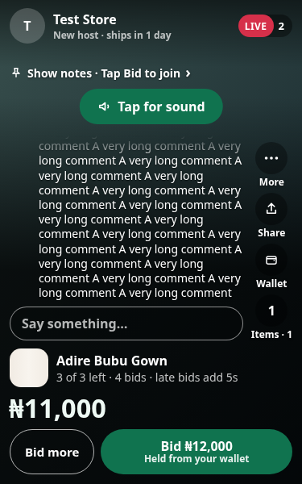
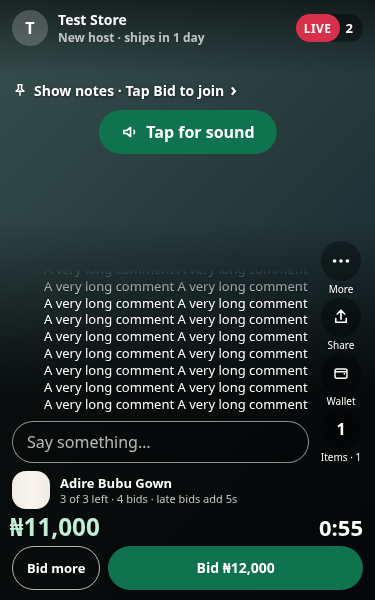
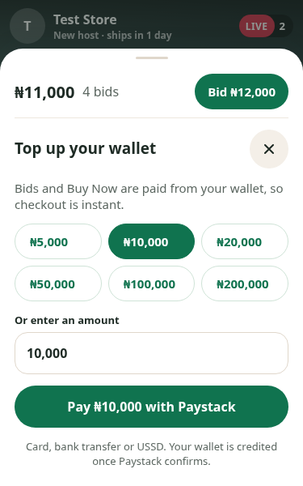
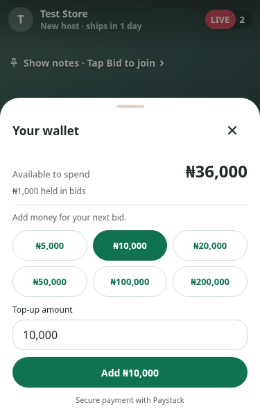
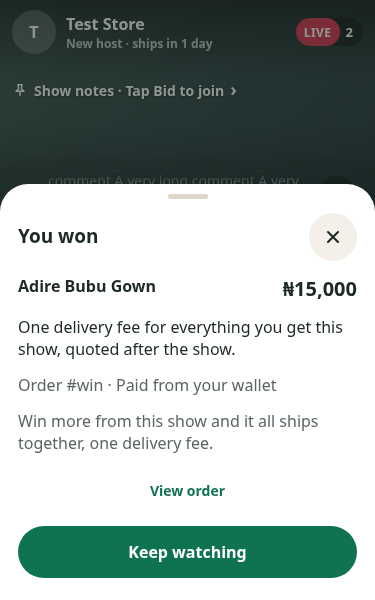
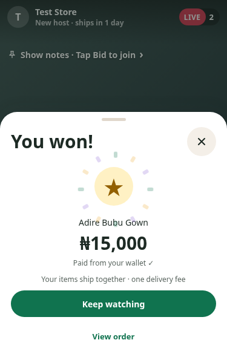
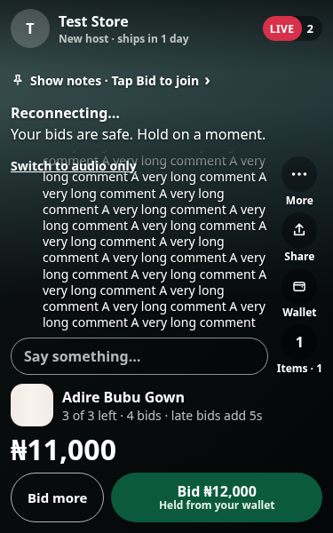
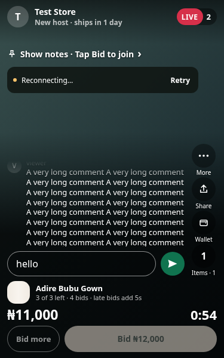

# Live-show mobile layout and recovery

Before/after captures use the same local API and Agora mocks at 375×600. The
plain video background is a fixture, not a real stream or staging recording.

| Screen | Before | After |
| --- | --- | --- |
| Live view |  |  |
| Wallet |  |  |
| Win |  |  |
| Reconnect |  |  |

## Automated checks

- `cd buyer-web && npm test && npm run build`
- `cd seller-web && npm test && npm run build`
- Buyer browser checks: start buyer Vite with
  `VITE_API_BASE_URL=http://localhost:8000 npm run dev -- --host 127.0.0.1`.
  From the repository root run `node buyer-web/tests/watch.browser.mjs`.
- Seller capture checks: start seller Vite with the same API base, then run
  `node seller-web/tests/live-media.browser.mjs` from the repository root.
- Browser scripts need Playwright and Chromium. Set `PLAYWRIGHT_MODULE` to the
  installed Playwright module path if it is not on Node's module lookup path;
  `CHROMIUM_PATH` defaults to `/usr/bin/chromium`. `SCREENSHOT_DIR` saves buyer
  captures; both scripts stub API/SDK traffic and never pay or create accounts.

Buyer browser checks cover 320×568, 375×600, 390×700 and 1280×800: long chat,
compact wallet with a refreshed balance, a real hit test on the host-resume
button, preserving audio-only after republish, new item/timer after reconnect,
new item after pageshow, the win sheet, and both live-end notification names.
A missed end notification is tested by ending the snapshot while the viewer is
away, then triggering the persisted pageshow event.

Seller browser checks exercise native MediaStreamTracks using Chromium's fake
capture devices, including StrictMode's overlapping preflight requests. All
tracks must be ended before a delayed end-show API response returns, even when
RTC leave never resolves. A microphone failure with a late camera result must
also leave no live track. Unit tests cover scoped ownership, partial failures,
and throwing SDK stop methods. These are not physical iPhone camera tests.

## Physical iPhone check after deployment

Use existing accounts; do not create test accounts or enter credentials in chat.

1. Open a live show on the smallest available iPhone. Chat must scroll within
   its area, leaving the host and bid controls visible. Open/close the keyboard.
2. Pause video from More, then tap Show the host again. Test audio-only too.
3. Open Wallet: confirm available funds, reopen after an outbid/top-up, and
   confirm the refreshed amount. No payment is needed just to check the layout.
4. Background the buyer, change the displayed item on the seller, then return.
   Product, price, notes and countdown should match without refreshing the page.
5. End the show while the buyer is watching: it should reach Show ended.
   Repeat with the buyer backgrounded; returning must reach the ended screen.
6. On the seller device, open the camera check, go live, then End show. The
   camera/microphone indicators should clear. Repeat with slow networking and
   after switching cameras. Failed end requests must leave capture off and let
   the host retry marking the show ended.
