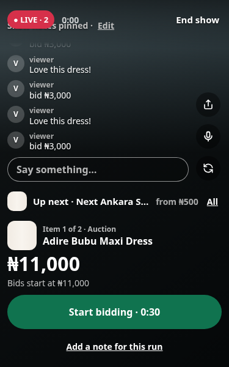
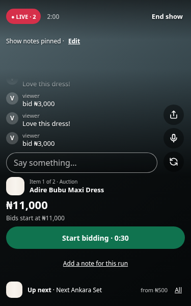
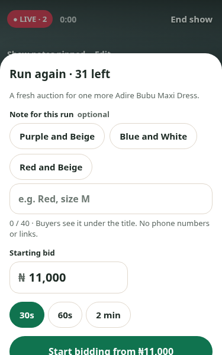
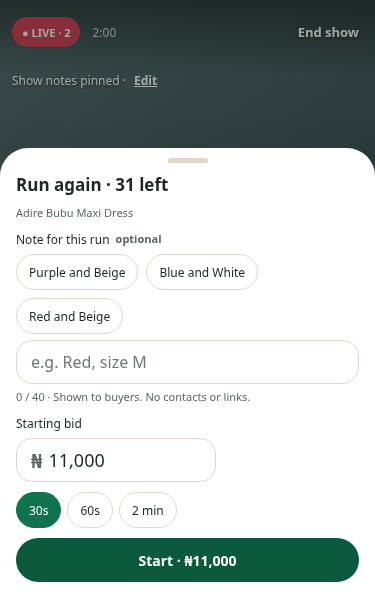
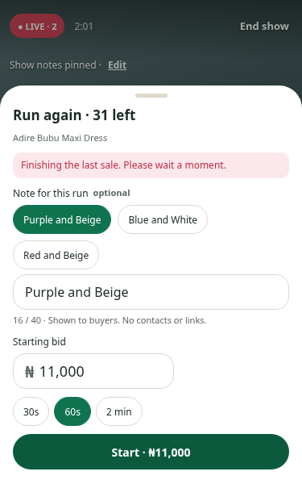

# Seller studio: Run again and foreground recovery

The captures below use a local mocked show at 375×600, not a staging broadcast.

| Screen | Before | After |
| --- | --- | --- |
| Studio |  |  |
| Run again |  |  |

## Changes

- The end-bidding controller now marks finalised runs `ended`, after order
  processing, and reloads the committed stock/hold/order state. It appends end
  notifications without saving an older stream document over newer run data.
- Run again is offered only when the server confirms settlement and stock.
  A zero timer or winner notification alone cannot unlock it. While settlement
  completes, the studio says “Finishing sale…” and polls for completion.
- Older `ongoing` records can be repaired on Run again only with no outstanding
  hold and either an order ID plus `orderCreated`, or no bid/bidder/winner at all.
  Outstanding wallet holds remain protected. Missing legacy run counters start
  their next run at 2, keeping its payment reference distinct from the first.
- Foreground, persisted pageshow, online and socket reconnect refresh the scene,
  selected item, notes, stock, sales, elapsed time and deadline. A newer event
  invalidates an older in-flight snapshot. Countdown ticks resume locally while
  socket events catch up, and ended shows reach recap. A disconnected/dead local
  media track restarts through the existing scoped cleanup; mute is retained.
- Studio fonts and weight, price/timer, buttons and Run again chips are smaller.
  Notes move above the camera, chat height is bounded, item actions come before
  Up next, and errors stay inside the run sheet without clearing its fields.
  Numeric/text inputs retain 16px text to avoid iOS focus zoom.

## Checks

- `cd server && MONGOMS_SYSTEM_BINARY=/workspace/.local/bin/mongod npm run test:ci -- --runInBand tests/services/auctionOrderService.test.js tests/services/auctionClock.test.js tests/routes/studioRoutes.test.js`
- `cd seller-web && npm test && npm run build`
- Start seller Vite with `VITE_API_BASE_URL=http://localhost:8000 npm run dev`.
  From the repository root run `node seller-web/tests/studio-recovery.browser.mjs`.
  The script needs Playwright and Chromium; set `PLAYWRIGHT_MODULE` to an installed
  module path if necessary. `SCREENSHOT_DIR` saves captures. `SELLER_TEST_URL`
  overrides the local URL. It stubs API, socket and SDK calls; no account or
  live broadcast is created.
- `node seller-web/tests/live-media.browser.mjs` keeps the existing native
  fake-device capture-release checks covered too.

Backend regressions exercise the real end-bidding controller on sold and unsold
runs, then Run again, preserving wallet balances, stock, and order counts. They
also cover safe legacy repair, missing counters and refusal during a wallet hold.
Browser checks cover 320×568, 375×600, 390×700 and desktop: run retries preserve
note/duration, incomplete settlement never exposes Run again, resume selects the
latest item and restores a ticking timer, mute survives RTC restart, and ended
shows leave the studio.

## Physical iPhone check after deployment

Use an existing seller account. End a sold run with stock remaining, wait for
settlement, and run it again with another colour note. Repeat an unsold run.
Background/minimise Chrome during a live auction; return after a price/item
change and check the item, countdown, stock and mute state without a page refresh.
Repeat after the show has ended elsewhere: the seller should reach recap.
Check the smallest iPhone with chat and the keyboard open, and verify the run
sheet action remains reachable. These physical-device checks are still needed;
the automated tests emulate viewport and page lifecycle events.
